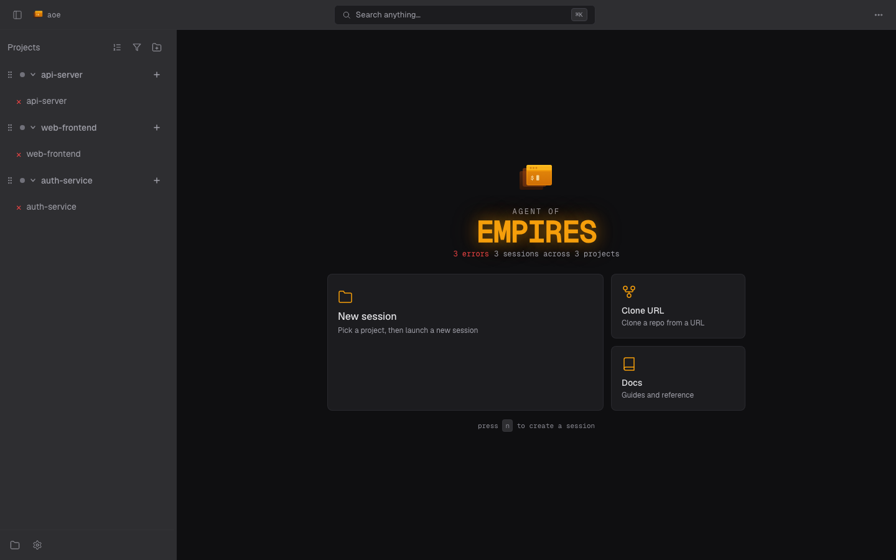

# Web Dashboard

Monitor and drive agent sessions from any browser. Web serving is part of the `aoe` Daemon; start it with `aoe serve`. Terminal sessions run in tmux and structured sessions use persistent workers, so browser crashes and reconnects do not stop the work.



This page covers launch, access modes, security and PWA installation. Other surfaces have their own guides:

- **[Dashboard & workspaces](web/dashboard.md)**: layout, session wizard, sorting, grouping, triage and mobile behavior.
- **[Terminal view](web/terminal.md)**: agent and paired terminals, reconnects and read-only mode.
- **[Diff view](diff-view.md)**: changes, comparison bases and inline review.
- **[Configuration](configuration.md)** and [Security](#security): settings, profiles and connected devices.

The dashboard ships in release binaries. Source builds need the `web` Cargo feature and Node.js; plain `cargo build` still serves the API without a dashboard.

## Starting the server

```bash
aoe serve                       # Localhost only (default)
aoe serve --remote              # Remote over HTTPS (Tailscale Funnel, else Cloudflare quick tunnel)
aoe serve --host 0.0.0.0        # LAN/VPN bind; plain-HTTP peers get 426 unless --dangerously-allow-plaintext-remote
aoe serve --daemon              # Run in the background (--stop to stop it)
aoe daemon start                # Same; also stop, status, restart
aoe serve --open                # Open the URL in a browser when ready
aoe serve --remote --read-only  # Monitor without sending keystrokes
```

From the TUI, press `R` (`Ctrl+R` with strict hotkeys), shown as `R Web` in the shortcut bar, to open Connections, then Enter on **Web dashboard** to start a background server on your network or over a tunnel. While it runs, the entry reads `R ● Web` in green. When the Daemon needs attention, the entry shows that instead, in red for a problem (`R ● Runtime outcome unknown`) or dim for a limit (`R ● Unavailable`), and Connections lists the Daemon with what it means. If the Daemon goes offline, Connections replaces the home screen, with `r` to reconnect.

The Daemon prints a URL carrying an auth token. Open it in a browser; the token becomes a cookie on first visit.

When a poll expires, the dashboard aborts its request and shows the server as
unreachable while retaining the last session list and workspace order. A later
successful poll restores the online state. A save acknowledgement alone does not
clear a cancelled color or notification choice; it is reconciled against the
affected sessions' canonical mutation results.

`--open` is suppressed with `--daemon`, `--remote`, SSH without a forwarded `DISPLAY`, or a Linux/BSD host without a display server. `BROWSER` overrides that visibility check where the platform launcher supports it, not on macOS. Preview links use the same rules.

### Private API and recovery

Run only the private local API, without TCP or a dashboard, with:

```bash
aoe serve --core-only --daemon
```

An explicit `aoe serve` request enables Web serving by replacing a managed private-API Daemon under its lifecycle lock. It validates the requested exposure before stopping the old process, waits for dashboard readiness, and leaves terminal sessions running. Successful promotion retains the prior private-API launch for explicit recovery.

`aoe serve --restart` replays the current managed launch. A failed replacement has no automatic fallback: use `aoe serve --rollback` to restore the retained launch, including after `--stop` or when the web plugin is disabled. Missing or mismatched credentials refuse rollback rather than dropping authentication; unavailable prerequisites can still make replay fail.

Local restarts from the TUI preserve the running dashboard's effective passphrase, including when a newly opened TUI has no `AOE_SERVE_PASSPHRASE` variable. Restart refuses before stopping the running Daemon if its required credential cannot be recovered. Generating a new Tunnel passphrase explicitly replaces that credential.

The retained launch and credential stay private (`0600`). Restart or rollback consumes them only after readiness; failed replay retains them. Promotion to Web serving does not consume the private-API recovery pair. Stop foreground or service-supervised processes through their owning shell or manager before rollback replaces them.

When the TUI starts or restarts a dashboard, its Remote Access view stays open while the Daemon changes. The TUI accepts exactly one verified successor connection for that request. Existing form and paste drafts stay in memory; native attach and live-send continuations stop. Pending changes with an unknown outcome stay blocked and are never replayed automatically. A failed start remains visible in Remote Access; close it and reconnect explicitly after repairing the cause. Stop remains responsive while startup settles: the TUI stops asynchronously afterward and does not reconnect or queue another start. Closing Remote Access does not discard other drafts.

A degraded runtime can still provide its last complete canonical list read-only. Owner diagnostics name the file that actually failed, without displaying its contents. If the failing source changes while the list stays unchanged, an already-connected owner TUI updates the diagnostic without inventing a new list revision. Repair that file and wait for a fresh healthy snapshot before writing. A runtime protocol mismatch requires `aoe serve --restart`; reconnecting does not silently replace a live incompatible Daemon.

### Retrieving the live URL

In `--remote` mode the token rotates every four hours. Use `aoe url` for the live URL (`--all` for labeled URLs, `--token-only` for scripted login); it exits non-zero if no Daemon runs. Remote mode also prints a phone-pairing QR code.

## Remote access

`--remote` selects a tunnel in this order, unless named-tunnel flags override it:

1. **Tailscale Funnel:** if `tailscale` is installed and logged in, AoE runs `tailscale funnel --bg --yes <port>` for a stable `https://<machine>.<tailnet>.ts.net` URL. Install Tailscale, run `tailscale up`, enable [Funnel](https://login.tailscale.com/f/funnel), and grant the node the `funnel` nodeAttr in its [ACL](https://login.tailscale.com/admin/acls/file). Target the node's tag if tagged. A conflicting non-loopback Funnel on port 443 is refused, not replaced; clear it with `tailscale funnel reset`, or use `--no-tailscale`. Stale loopback AoE configuration can be replaced.
2. **Named Cloudflare tunnel:** an explicit named tunnel takes precedence over Tailscale and provides a stable hostname on your domain:

   ```bash
   cloudflared tunnel create my-tunnel
   # Add a CNAME: aoe.example.com -> <tunnel-id>.cfargotunnel.com
   aoe serve --remote --tunnel-name my-tunnel --tunnel-url aoe.example.com
   ```

3. **Cloudflare quick tunnel:** the fallback requires [`cloudflared`](https://developers.cloudflare.com/cloudflare-one/connections/connect-networks/downloads/) on the host. No domain or account is needed, but the URL changes on restart and breaks installed PWAs. AoE reports this fallback. Install PWAs from a stable Funnel or named-tunnel URL.

## Flags

| Flag | Default | Description |
|------|---------|-------------|
| `--port` | 8080 | Port to listen on |
| `--host` | 127.0.0.1 | Bind address; `0.0.0.0` for LAN/VPN access |
| `--auth` | `token` | `token` (URL token), `passphrase` (login wall only), `none` (loopback only unless `--behind-proxy`). `--no-auth` is an alias for `none` |
| `--passphrase` | | Passphrase for the login wall, also read from `AOE_SERVE_PASSPHRASE`. Valid with `--auth=token` and `--auth=passphrase` |
| `--behind-proxy` | off | An external proxy terminates TLS: sets `; Secure` cookies and trusts `X-Forwarded-For` and `X-Forwarded-Proto` only from loopback peers. Spawns no tunnel and requires at least one `--allowed-host` |
| `--dangerously-allow-plaintext-remote` | off | Accept plain HTTP from non-loopback peers instead of answering `426`; see [Security](#security) |
| `--allowed-host` | | Extra `Host` the [DNS-rebinding gate](#dns-rebinding) accepts (repeatable) |
| `--allowed-origin` | | Extra browser `Origin` to accept (repeatable, full `scheme://host[:port]`); only needed for a proxy on a nonstandard port |
| `--remote` | off | Expose over an HTTPS tunnel |
| `--tunnel-name` / `--tunnel-url` | | Use a named Cloudflare tunnel and its hostname (with `--remote`) |
| `--no-tailscale` | off | Skip Tailscale auto-detection and use Cloudflare |
| `--read-only` | off | View terminals but send no keystrokes |
| `--daemon` / `--stop` | off | Fork to the background, or stop a running daemon |

`--auth=passphrase` and `--auth=none` on a non-loopback bind require `--behind-proxy`. Passphrase mode requires `--passphrase` or `AOE_SERVE_PASSPHRASE`; combining a passphrase with `--auth=none` is refused. Public `--remote` tunnels require both token auth and a passphrase and refuse reduced-auth modes. See [Authentication](#authentication).

### CityHall client mode

Set `AOE_CITYHALL_MODE` to any value, or pass `--cityhall`, for a locked-down end-user client. Only the message composer and structured view are reachable. Terminal/raw-output and diff routes, git probes, project/profile management, agent/worker/config controls, MCP keep/drop/resolve, and plugin lifecycle are hidden and refused server-side. Mutating routes are default-deny unless explicitly allowlisted.

Session creation resets client-controlled spawn fields, including `command_override` and `trust_hooks`, and derives the launch on the server. Lists include only the structured sessions this mode creates; lifecycle routes refuse non-structured targets. New sessions accept a name only, span every configured project, and require an ACP-capable default agent and at least one project. Worktrees default on and the worker ceiling is raised.

Settings expose Theme without color-mode or idle-decay controls, field-filtered trash settings, Telemetry, and display-only MCP servers and Plugins. Other settings and profile switching stay unavailable. The mode persists in `serve.launch` across `--restart` and post-update re-exec.

#### The CityHall config bundle

A bundle configures a locked-down client with one TOML document:

```toml
schema_version = 1

[settings.acp]
default_agent = "claude-code"

[[projects]]
name = "cityhall"
remote = "https://github.com/agent-of-empires/cityhall.git"
default_base_branch = "main"
```

Projects use git remotes, not the administrator's paths; `apply` clones into `<app_dir>/repos/<name>` and registers them. Settings are sparse section/field patches, validated like `PATCH /api/settings`.

Export with `aoe cityhall export --out cityhall.toml` or **Settings > CityHall**. Exports omit host-specific/local-only fields and all credentials. Apply with `aoe cityhall apply cityhall.toml`. Application is idempotent: existing checkouts and uncommitted work stay untouched, registrations are not duplicated, and one failed clone does not stop others. Bundles set values but cannot unset them.

`AOE_CITYHALL_BUNDLE_URL` fetches a bundle before config loading; `AOE_CITYHALL_BUNDLE_TOKEN` supplies its bearer token. Without a cached bundle, fetch failure aborts startup. After a successful application, later fetch failure warns and uses the cache. Malformed bundles or unknown settings remain fatal.

The serving host can compose a per-user `[git]` identity and credential for clone, pull and push. Export never writes that section.

### Behind a reverse proxy

When TLS is terminated by an external proxy (Traefik, nginx, Caddy) forwarding to `aoe serve` on loopback (often through an SSH reverse tunnel), use `--behind-proxy` so cookies carry `; Secure` and the rate limiter keys by the real client IP:

```bash
aoe serve \
  --host 127.0.0.1 --port 42041 \
  --auth=passphrase --passphrase "$AOE_PASSPHRASE" \
  --behind-proxy \
  --allowed-host aoe.example.com
```

The upstream must set `X-Forwarded-For` and `X-Forwarded-Proto: https`; aoe reads the last value of each, and only when the socket peer is loopback, so a client or misconfigured upstream cannot spoof them. `--remote` over a Cloudflare tunnel also supplies `cf-connecting-ip`; `--behind-proxy` and Tailscale Funnel ignore it because a proxy can pass a client-chosen one through. A request whose client address is missing or malformed shares one rate-limit bucket. A loopback proxy that omits `X-Forwarded-Proto` makes no HTTPS assertion and is not refused; only an explicit non-`https` value gets `426`.

The local TUI and local `aoe acp` commands use the owner-verified Unix API, not a browser login or `serve.passphrase`. See [Cross-machine attach](../structured-view.md#cross-machine-attach) for explicit TCP and remote ACP authentication.

`--behind-proxy` requires at least one `--allowed-host <public-hostname>`: aoe cannot infer the hostname your proxy forwards, and the [DNS-rebinding gate](#dns-rebinding) rejects any `Host` it does not recognize. If the proxy listens on a nonstandard port, also pass the exact origin, e.g. `--allowed-origin https://aoe.example.com:8443`. The daemon refuses to start (with an explicit message) if `--behind-proxy` is set without `--allowed-host`.

### Running under systemd or launchd

`aoe daemon start|stop|status|restart` are the `aoe serve --daemon|--stop|--status|--restart` controls. To let the OS own the daemon instead, run foreground `aoe serve` from a service unit, with no `--daemon` and no exposure flags. Substitute the absolute path from `command -v aoe`.

`~/.config/systemd/user/aoe.service`, enabled with `systemctl --user enable --now aoe.service`:

```ini
[Unit]
Description=Agent of Empires daemon

[Service]
Type=notify
ExecStart=/path/to/aoe serve
Restart=on-failure
KillMode=process

[Install]
WantedBy=default.target
```

`KillMode=process` keeps a tmux server the daemon started, and every pane, alive across `systemctl --user stop` and `restart`, at the cost of leaving the daemon's other child processes running after a stop. Alternatively drop it and select a dedicated `tmux.socket_name` whose server starts outside the daemon; see [systemd](configuration.md#systemd).

`~/Library/LaunchAgents/com.agentofempires.daemon.plist`, loaded with `launchctl bootstrap gui/$(id -u) "$HOME/Library/LaunchAgents/com.agentofempires.daemon.plist"`:

```xml
<?xml version="1.0" encoding="UTF-8"?>
<!DOCTYPE plist PUBLIC "-//Apple//DTD PLIST 1.0//EN" "http://www.apple.com/DTDs/PropertyList-1.0.dtd">
<plist version="1.0">
<dict>
  <key>Label</key><string>com.agentofempires.daemon</string>
  <key>ProgramArguments</key><array><string>/path/to/aoe</string><string>serve</string></array>
  <key>RunAtLoad</key><true/>
  <key>KeepAlive</key><dict><key>SuccessfulExit</key><false/></dict>
</dict>
</plist>
```

Control a manager-owned daemon with `systemctl --user` or `launchctl`, not `aoe daemon`: with `Restart=on-failure` and `SuccessfulExit=false` a stop through aoe leaves the unit inactive, and `aoe daemon start` would run a second, unmanaged daemon. The daemon inherits the service manager's `PATH`, so set it to include `tmux` and your agents. Give a debug build its own unit name or label so it does not replace the release one.

`aoe serve` supports `Type=notify` when `NOTIFY_SOCKET` is set, using pathname or Linux abstract (`@name`) sockets. It sends `READY=1` after binding the required TCP and owner-verified Unix listeners, publishing the first canonical snapshot, and starting workers/tasks; it sends `STOPPING=1` when shutdown starts. A quarantined component does not stop healthy CLI reads, but native health and mutation admission remain fail-closed. Supported local runtime-read publication waits for retained readers before readiness; CityHall and unsupported namespaces keep their no-publication behavior. Writes run outside async workers and each has a one-second timeout; a receiver that remains full can still cause `READY=1` to be lost. Wrappers such as `cargo run` require `NotifyAccess=all`.

## Security

**The dashboard exposes terminal access.** Anyone who authenticates can send keystrokes to your agent sessions, which run as your user.

### Authentication

**Compatibility:** TCP loopback no longer grants local-owner trust. With a
passphrase configured, a same-host browser must sign in and confirm the
passphrase again for sensitive writes, even without `--behind-proxy`. Only
native clients on the owner-verified Unix API retain the local-owner exemption.

- **Token auth** (`--auth=token`, default): a random 256-bit token, generated on startup and stored at `~/.config/agent-of-empires/serve.token` (Linux) or `~/.agent-of-empires/serve.token` (macOS). Passed via URL on first visit, then kept as an `HttpOnly; SameSite=Strict` cookie.
- **Passphrase wall** (`--auth=passphrase`, or combined with token via `--passphrase`): an argon2-hashed passphrase gates `/login`. Sessions bind to a per-device secret in `localStorage`, so a leaked cookie alone is insufficient.
- **Plaintext refusal**: plain HTTP from a non-loopback peer gets `426` before authentication, so tokens and passphrases never cross a network in the clear. A TLS proxy or tunnel in front of a loopback bind is unaffected. A direct bind to a LAN or tailnet IP needs `--dangerously-allow-plaintext-remote` (per bind, logged at every start). Native clients likewise refuse to send a token or passphrase to a plaintext non-loopback endpoint.
- **Rate limiting**: 5 failed logins from an IP trigger a 15-minute lockout.
- **Token rotation**: in `--remote` mode the token rotates every 4 hours with a 5-minute grace period for active sessions.
- **Device tracking**: connected devices (the signed-in login sessions, with browser, origin IP, and last seen) are visible in Settings > Web Dashboard > Connected Devices, where you can revoke one device or sign every device out.
- **Session persistence**: login sessions are persisted to an owner-only `login_sessions.toml` in the app dir, so signed-in devices survive an `aoe serve` restart instead of being re-prompted for the passphrase. A passphrase change drops every persisted session; set `auth.persist_sessions = false` to force re-authentication on every restart.
- **Passkeys**: with a passphrase configured, enrol one under Settings > Web Dashboard > Connected Devices. Sign-in needs HTTPS or `localhost` and an allowlisted origin; a passkey works only on its enrolled origin. Public keys live in owner-only `passkeys.json`. Changing the passphrase removes all passkeys and login sessions. Adding or removing a passkey requires step-up passphrase confirmation; passkey sign-in does not satisfy step-up.
- **Step-up elevation**: writes that can plant code for, or widen, the next session spawn require passphrase confirmation valid for 15 minutes. This covers the `sandbox` and `worktree` sections plus `acp.restrict_agents`, `skills.auto_propagate`, `session.smart_rename_model`, and `session.inherit_host_environment`. The gate is per field; ordinary preference writes need no elevation. Passkey sign-in does not satisfy step-up.
- **Local-only fields**: the agent-command surface and status-hook shell commands map names to arbitrary host commands, so the server rejects any PATCH touching them; they are editable only in the TUI on the host.

The server also sets `X-Frame-Options: DENY`, `X-Content-Type-Options: nosniff`, and `Referrer-Policy: no-referrer` (the last prevents token leaks via Referer).

### Plugin pages

A plugin page is framed with `sandbox="allow-scripts allow-downloads"` and served under its own policy (see [Pages](../plugin-api.md#pages)), so its script runs in an opaque origin: it cannot read the dashboard's token, binding secret, storage or cookies, call the API, or navigate the dashboard; it can save files to the downloads folder, subject to the browser's download protections. Because a frame load cannot send the device-binding header, the dashboard first mints a page ticket through a bound request. The ticket rides an `HttpOnly` cookie scoped to that page's URL, lasts 60 seconds, and authenticates only that page for the still-signed-in session that minted it; it never appears in the frame URL or document. That route is the only one framable, and only by the dashboard.

### DNS rebinding

`aoe serve` checks `Host` and browser `Origin` before authentication. An unlisted host, or an origin neither allowlisted nor on the same host and effective port, receives `403 Forbidden`. This includes default ports and bracketed IPv6. Requests without `Origin` skip only the origin check; `Origin: null` is refused and cannot be allowlisted.

Automatic hosts include `localhost`, `127.0.0.1`, `::1`, a concrete bind address and routable IP literals. A browser origin for an IP literal must still match that host's exact authority. Unspecified, link-local and multicast addresses cannot be trusted or explicitly allowlisted. Remote tunnels add their public hostname and HTTPS origin.

A wildcard bind is reachable by LAN or tailnet **IP** without another flag. Hostnames, including mDNS, MagicDNS and custom tunnel names, require an explicit allowlist entry:

```bash
aoe serve --host 0.0.0.0 --allowed-host my-box.tailnet.ts.net
```

### `--allowed-host` for a reverse proxy or custom tunnel

Declare the public hostname with `--allowed-host`. Standard HTTP/HTTPS origins on ports 80/443 are derived automatically; add the full `--allowed-origin` for a nonstandard port:

```bash
aoe serve --host 127.0.0.1 --behind-proxy \
  --allowed-host aoe.example.com \
  --allowed-origin https://aoe.example.com:8443
```

Both flags are repeatable and replayed across `aoe serve --restart`.

### Safe usage patterns

- **Localhost** (`aoe serve`): same security as the TUI.
- **Remote via tunnel** (`aoe serve --remote`): encrypted via HTTPS. Recommended for phone access.
- **Over Tailscale/WireGuard** (`aoe serve --host 0.0.0.0 --dangerously-allow-plaintext-remote`): the VPN encrypts traffic, but aoe cannot verify that, so the opt-out is required; reach it at `http://<tailnet-or-lan-ip>:8080`.
- **Behind a reverse proxy** (`--auth=passphrase --behind-proxy`): TLS terminated upstream; passphrase is the only human gate.
- **Read-only** (`aoe serve --remote --read-only`): monitor without input.

### Dangerous (blocked)

- `aoe serve --host 0.0.0.0` on public WiFi without a VPN: unencrypted HTTP, which is why it is refused with `426` unless you pass `--dangerously-allow-plaintext-remote`.
- `aoe serve --auth=none --host 0.0.0.0` (or `--no-auth --host 0.0.0.0`): refuses to start without `--behind-proxy`.
- `aoe serve --auth=none --remote` or `--auth=passphrase --remote`: refuses to start.

## Installing as a PWA

Install the dashboard as a Progressive Web App: Chrome's **Install Agent of Empires**, Safari's **File > Add to Dock**, iOS **Share > Add to Home Screen**, or Android's install prompt. Use a stable Funnel or named-Cloudflare URL; a quick-tunnel URL changes on restart.

Keep the Daemon running with `--daemon`; stop it with `aoe serve --stop`. The PWA returns to the last session on that device, or the dashboard if no session was selected or that session is gone. Stopping a foreground or background Daemon exits within about five seconds with open tabs; clients receive `1001` (going away) and reconnect when a new Daemon runs.
