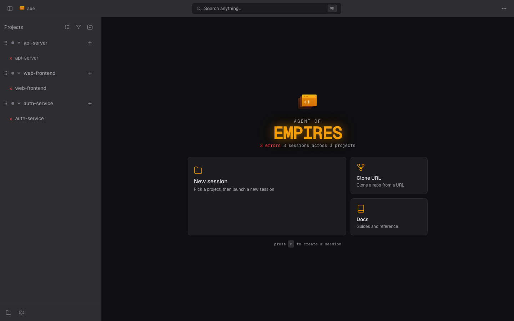
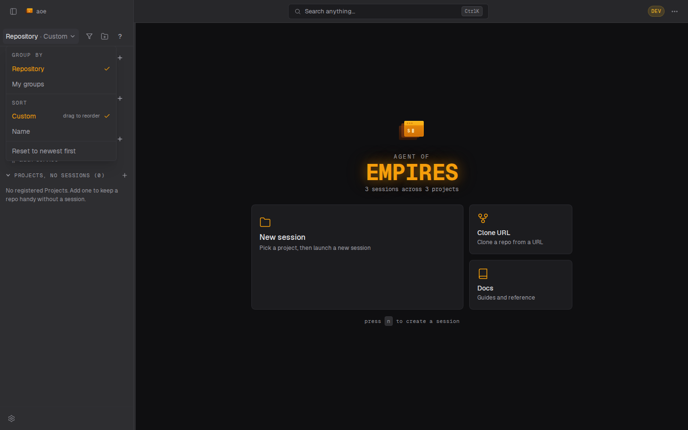
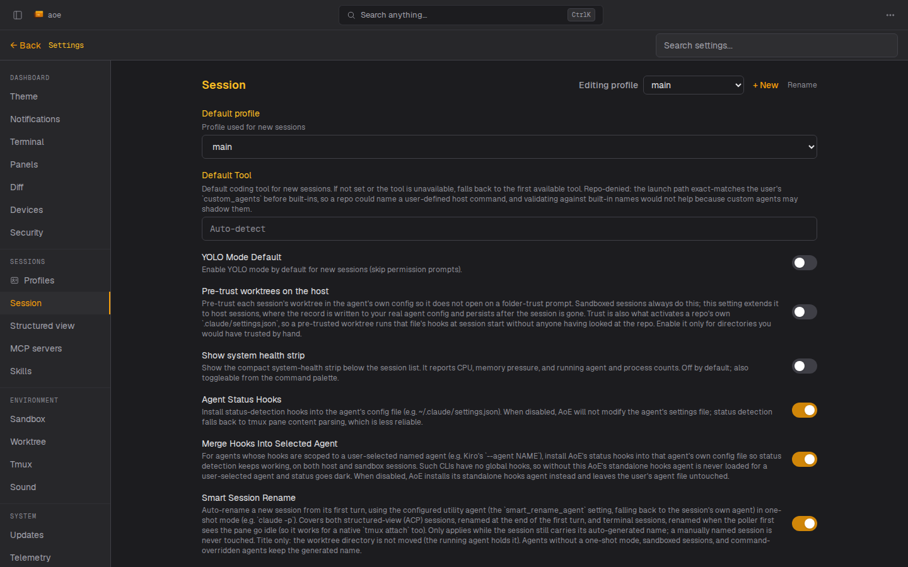

# Dashboard & Workspaces

The dashboard is the home screen of the web app: a workspace sidebar on the left, the active session in the main pane, and a top bar with global actions. This page covers the layout, creating a session, and keeping a long session list under control. For running the server and auth, see the [Web Dashboard overview](../web-dashboard.md).

## Layout

- **Workspace sidebar** (left) starts with **New session** and **Search** (the command palette, also **Ctrl+K**, **⌘K** on a Mac), then lists every session grouped by repo, with a live status glyph per row; the open session's row is a filled pill. On a phone it is a drawer (see [On mobile](#on-mobile)). On wider screens, drag its right edge to resize it: below the minimum width it snaps to a compact rail of glyphs and short titles, and further still it closes, until the top-bar toggle reopens it as it was. Focus the edge to resize it with the arrow keys, **Home** for the rail and **Enter** to collapse to or restore from the rail; double-click it to reset the width. With no sessions, it shows a hint and a **New session** button.
- **Main pane** shows the selected session: the agent terminal (or structured view), with the review panel (right dock, the paired terminal stacked below its review panes) reachable from the top bar.
- **Top bar** names the open session as `project / title` on desktop (elsewhere it carries the command-palette trigger), then the terminal and review panel buttons and the overflow (three-dot) **More options** menu.
- **Home screen** (no session selected) shows the AoE logo and a count of running, waiting, and error sessions.

### Side panels

The review panel (the right dock) and the terminal start closed. The top bar has a button for each: the review panel button opens Diff when the panel is empty and, while the panel is closed, shows how many files had changed when you opened the Session. The chevron beside the review panel button opens a menu that opens or closes Diff, Files, Background and plugin panes. A Session keeps the panels you open or close in it, in that browser. Terminal tabs open in the right dock below the review panes and are the exception: each shows one Session's shell and stays open as you switch Sessions (see [Paired terminal](terminal.md#paired-terminal)). **Settings > Panels** sets the defaults; they apply to every Session whose panels you haven't changed.

The right dock is the Session's review panel: **Diff**, **Files**, **Background** (structured-view sessions) and plugin panes, in that order. Picking a file in Diff opens it in the main area with an **Agent | <file>** tab strip above it: **Agent** returns to the session without closing the file, the file tab brings it back, and **×** closes it. Picking another file replaces it. Files opens a picked file inside the pane, with a back button to the file list. The **maximize** button on the right dock's tab strip lets the dock take the whole main area until you restore it; a reload restores it too. Between 768px and 1100px of window width the right dock opens as a sheet over the main area instead of a third column; **Escape** or a click outside closes it, and picking a file in Diff closes it to show the file.

The Diff pane's **Branch | Uncommitted** picker sets what the working tree is compared against: **Branch** (the default) shows the branch's changes since it left its base branch, which the base picker beside it chooses; **Uncommitted** shows what isn't committed yet. Untracked files count as changes in both. The file list, the open file and the changed-file count follow the picked comparison, and this browser remembers it per Session.

### Status glyphs

Each sidebar row carries an animated braille glyph encoding the session's state: a spinner of dots while **Running**, an orbiting dot while **Waiting** or **Creating**, a slow breathe while **Starting** or freshly idle. Errors render in the error color. The frame is offset by each session's creation time so rows don't pulse in lockstep.

**Symbol legend** in the **⋯** menu opens a legend of every glyph and mark: the status glyphs, Unread, Pinned Session, Project, Pinned project and the Group dot. It's a popover on desktop and a sheet on a phone. Hovering a glyph or mark with a mouse shows what it means, and a row that needs attention for another reason adds that on a second line. With a row focused from the keyboard, its glyph's meaning shows too, along with **Press Enter to open**. Animated glyphs in the legend hold still when your system asks for reduced motion.

An Error row's tooltip shows the first line of the error AoE recorded for the session, or says that none was recorded. Opening a Terminal view session in Error doesn't restart it. It shows that error in full, with **Copy error** and **Restart**, so on a phone you tap the row to read it.

## Editing project files

Editing is off by default. Enable **Settings > Panels > Edit project text files** in the browser, then open an existing file in **Files** and select **Edit**.

- Save or Cancel in the viewer. Ctrl/Cmd+S and Esc apply only while the text area has focus. Confirm before leaving the edited view with unsaved changes; changing another pane does not ask. Unsaved text survives resizing or rotating across the phone layout. Resizing does not duplicate or cancel a pending save.
- Existing UTF-8 text files up to 5 MB only. Read-only dashboards, out-of-project transcript files, and Sandbox folders backed by separate volumes and individual file bind mounts stay read-only with a reason. Files are unavailable in CityHall mode.
- Saves retain consistent LF, CRLF or CR endings and the edited text's trailing newline. Mixed endings follow line position and can shift after lines are inserted or removed.
- Saves retain ordinary file permissions and clear special permission bits.
- Saves use a [verified atomic exchange](../../api.md#get-and-put-apisessionsidfile). A conflict keeps your draft; copy your edits or reload. If another writer prevents restoration, check the reported `<filename>.aoe-conflict[.N]` recovery file beside the original. The editor polls for external changes while open.
- Filesystems without atomic exchange support disable editing with a reason. An uncertain-save error means the write may already be on disk; check the file before retrying.
- Temporary Sandbox verification failures pause saving and show a reason. Saving resumes when verification succeeds, keeping the draft.
- Turning editing off hides the editor and parks unsaved text. Turn it back on to resume the same draft and opened version.
- Trash and permanent deletion ask before discarding unsaved drafts, including parked drafts.
- After saving, optionally draft a note in Structured view without submitting it. Terminal view shows a reminder to tell the agent.

## Creating a session

The **New session** wizard is one screen of one-line rows, like the TUI dialog; a row with a chevron opens its details in a panel:

- **Project**: pick the working directory from the Recent tab, browse for one, clone a URL, or start a scratch session with no path. The Recent tab lists your registered Projects under a "Projects" section above the directories of your recent sessions. The recent list keeps a project around after its last session is deleted, so you can quickly start there again; entries whose directory no longer exists are dropped.
- **Title**: auto-slugifies into a worktree branch name unless you edit the branch.
- **Group**: search existing groups, including empty groups, or select the create row for a new name; surrounding spaces are trimmed on selection and `/` nests groups. Counts show sessions directly in the group, excluding archived and trashed sessions. Escape closes the suggestions without closing the wizard.
- **Agent**: the tool, plus instructions, command override, and extra args.
- **Structured**, **Yolo mode**, **Worktree**, and **Sandbox** switches; the Worktree and Sandbox rows open their branch, base, image, and env options.

Choosing a profile (the **Profile** row, shown when there is more than one) seeds these defaults; switching profiles after you have edited a field asks first. A create that runs `on_create` hooks shows their output while it runs, and **Continue in background** closes the wizard and reports the result when it finishes.
If the daemon refuses the create, the wizard stays open and says what failed and at which step. For a Sandbox or Project failure, it outlines the row that caused it. It offers the fixes that apply, such as **Retry** once the container runtime is running or **Launch without Sandbox**. Its reference finds the failure in `debug.log`. A create the daemon refuses after **Continue in background** shows a notice whose **Reopen** brings the wizard back with the same form, unless the connection dropped while it was sent.
Renaming a profile in either Settings surface refreshes the served-profile
authority before an implicit wizard reads profile settings or projects. Failed
refreshes keep Launch disabled and offer Retry server profile without discarding edits.

A plain New session opens on the project you launched last; pick another from Recent or Browse to change it.

## Command palette

The palette (top-bar button or keyboard shortcut) is a fuzzy launcher for global actions: jump to a session, open settings, start a session, toggle the right panel. With a session open, **Show only this Session** and **Open in its own window** do the same as the session menu entries in [Showing one session](#showing-one-session); "focus" and "pop out" find them too. In such a window, **Show all Sessions** returns to the regular view, and the commands that switch or create sessions are left out.

When an embedded agent or paired terminal, or the structured-session composer, has keyboard focus, press `Ctrl+Q` to return focus to the active session in the sidebar. Then press `a` to move to the next session needing attention; `a` works when a terminal or text field is not focused.

With a session row or Group header focused, use **↑** and **↓** to move through visible headers and rows without opening one; press **Enter** on a row to open it. On a Group header, **Enter** or **Space** collapses or expands it, **←** collapses it or, once collapsed, moves to its parent header, and **→** expands it or, once expanded, moves to its first row. **←** on a row moves to its header. The **Snoozed & archived** toggle works the same way, as the header of its rows. **Shift+F10** or the **Menu** key opens the header's menu. While a sidebar filter is active, every Group stays expanded: **Enter**, **Space** and **←** don't collapse it, and **→** moves to its first row. **Tab** stops once on the header itself, then on its **+** (New session) button; compact mode hides the **+**. When **Archive all** empties a Group, focus moves to the next Group header, or, for the last Group, the previous one.

Individual settings appear under `Settings`: a writable toggle flips inline with a toast, while read-only servers and settings needing elevation open the settings view instead. The Settings header has its own search box (the TUI settings screen uses `/`) that filters across every tab.

## First-run onboarding

Opening `/` on a writable dashboard sends you to the setup wizard at `/setup` until you finish it or click **Go to dashboard**. Its steps edit the regular settings, so a step shows as done once one of its settings differs from the default, wherever it was changed (the TUI, Settings or a hand-edited `config.toml`), or once you keep its defaults with **Next**. Only the Agents step is required. Skips, finishing, leaving early and dismissing the dashboard's **Finish setting up** banner are stored as the `setup_*` keys in `state.toml` (see [Configuration Reference](../configuration.md#statetoml)). Open `/setup` again at any time. Read-only and CityHall dashboards never show it.

Once setup is out of the way, an interactive walkthrough highlights the major regions (command bar, sidebar, starting a session, settings, and inside a session the diff panel and composer). Two of its steps open Settings for you: the Worktree tab, explaining the per-session path templates, and the Plugins tab, explaining how to find, install, and trust plugins. Each step lists its keyboard shortcuts and has a **Skip** button.

Completing or skipping the tour records `app_state.has_seen_web_tour` on the server, so it does not relaunch on reload or on another device pointed at the same server. That flag persists in the server's `state.toml` (a sibling of `config.toml`, see [Configuration Reference](../configuration.md#statetoml)); the `GET /api/settings` JSON key is unchanged, still `app_state.has_seen_web_tour`. To replay it, open the overflow menu and choose **Show tutorial**; re-triggering adapts to where you are (dashboard regions, or composer / mode picker / send controls inside a session). It does not auto-launch on touch devices, where it is menu-only.

While no plugin that provides suggestions is installed and a featured one exists, the homepage shows a one-line hint under the action cards. **Set up suggestions** opens a sheet that installs the featured providers you pick, then shows each plugin's setup checks (with its fix text and **Check again**). **More sources in the Marketplace** opens Settings > Plugins > Marketplace with the Suggestions filter on (`/settings/plugins?marketplace=suggestions`). The hint is skipped during the tour, on read-only and CityHall dashboards, and when the homepage section is off in Settings > Suggestions. Dismissing it stores `aoe-suggestions-hint-dismissed` in the synced web UI state, so it stays hidden on your other devices.

## Sidebar grouping and sort

The **View options** button (sliders icon) beside the **Sessions** label holds the sidebar's view in one menu: **Group by**, **Sort by**, **Filter sessions** and, when plugins add them, **Plugin facets**. A dot on the button means the view differs from the default: Repository, Custom, no filter. The grouping and sort are shared: the TUI and every browser on this server show the same pick, and a change made in one shows up in the others without a reload.

Each project header shows the project icon next to its name, with a count of the sessions it holds. Hovering the header swaps the icon for a fold chevron and shows its **+** (always shown on touch screens); clicking the header collapses or expands the project's sessions.

**Group by**:

- **Repository** (default): a header per git repository, with your Groups nested inside it. Sessions in no Group sit directly under the repository header. A session split across Groups appears once per Group.
- **Groups**: a header per user-defined Group, assigned in the TUI rename dialog, with `aoe group move`, or via **Move to another group** below. Ungrouped sessions sit in an **Ungrouped** bucket at the top, as in the TUI.

Collapse state is tracked per grouping and is not shared with the TUI.

**Sort by**:

- **Custom** (default): the order you set by dragging. Press and hold a row to move it within its header, or press and drag a repository header (there is no separate handle) to move the whole repository. Press and drag a Group header to move it among the Groups that share its parent, under either grouping. Groups follow each profile's Group order, which the TUI shows and moves too; ones never arranged follow by name. A Group shared by two profiles does not move, and a drop that cannot be made snaps back with a notice saying why. Rows and repository headers you never moved sit on top, newest first. The order is the one the TUI uses, stored in `workspace-ordering.json` and, for Groups, each profile's `groups.json`. While a move is saving, another drag is refused with "The last move is still saving".
- **Newest first**: rows by their newest session, newest on top, and headers by the newest session under them that is not archived or trashed, as in the TUI. Switching sorts keeps the Custom order.
- **Name**: rows A to Z by title, headers by name, ignoring case.
- Plugin sorts, when a plugin offers one, are listed below and apply only in this browser until you reload or pick another sort. Dragging is off while one applies.

Under Newest first or Name, dragging a row or a header switches to Custom, starting from the order on screen, Group headers included, so only what you dragged moves; the "Switched to Custom" notice offers **Undo**, which puts back the orders that drag rewrote and the previous sort, until the notice closes or the order or sort changes again, here or in another Client. When another Client changed the order first, Undo keeps that change and says so. When no Group order can keep the headers where they are, for example Groups of several profiles, the drag is refused and asks you to pick Custom first. When the switch fails the order is put back with a notice, unless a write may have saved, in which case the list shows what the Daemon holds.

Pinned rows stay at the top of their header under every sort. The Multi-repo and Scratch headers stay at the bottom. Header drag is off while a filter is active, and every drag is off while a plugin facet filters the rows. In CityHall client mode the grouping, the sort and the row and repository order are fixed; Group headers still move.

**Filter sessions** opens a text filter and a **Needs you** toggle, which shows only the rows with a session waiting on you, in error, flagged urgent, flagged by a plugin, or finished and not yet seen (while the unread indicator is on), under their headers, and hides the "Snoozed & archived" footer. Closing the filter clears both.

**Move to another group.** Right-click (long-press on touch) a session row and choose **More > Move to another group**. The dialog lists the profile's existing groups with the current one highlighted: pick one, or type a new path to create that group. **Remove from group** (or clearing the field) drops the session back to **Ungrouped**. With the list open, Enter picks the highlighted group and a second Enter saves; Escape closes the list, then the dialog. Group paths use `/` for hierarchy (e.g. `work/projects`). Hidden in read-only mode.

**Add project.** Attachment results stay open through Multi-repo regrouping.
Warnings and a failed worker restart remain visible until dismissed.
Accepted notification picks also survive collapse, filtering and
navigation to Settings. They retain exact sessions and runtime epoch, never
replay against replacement sessions or a replacement daemon.

## Triage: pin, archive, snooze, ignore

The right-click (long-press on touch) context menu on any session row exposes these triage primitives:

- **Pin**: floats the workspace to the top of its header in every sort. The TUI honors the same Pin, marks it with `◆` and toggles it with `f` (`F` in strict mode).
- **Archive**: tears down every tmux session the workspace owns (agent, web terminal, container terminal, and tool sub-sessions; pass `kill_pane: false` in the API body, or `--no-kill` on the CLI, to skip the tmux teardown) and shuts down the structured-view worker for ACP sessions, then sinks the row into the collapsible "Snoozed & archived" footer. Daemon restarts skip archived sessions. An archived session never starts or resumes, whether from a message, **Start**, attaching, or a daemon restart; unarchive it first. See #1868.
- **Snooze**: sinks the row for a chosen duration (presets: 1h, 2h, 3h, 4h, 5h, 6h, 1d, 1w). Wakes when the timer expires; sending a message wakes it early.
- **Ignore managed session**: for a session another session created or drives, hides it from attention badges and the Needs you filter while keeping it live and in the list. It is neither archived nor trashed, so it still starts and accepts direct user input, which clears the marker; non-user sends (MCP `send_to`, plugin messages and turns) return an `ignored` error until it is unignored or reclaimed. Pinning, archiving, or snoozing also clears the marker. **Take ownership back** in the same menu clears the manager link and the ignore marker together, leaving the session, its conversation, and its other triage marks untouched.

### Showing one session

Under **More** in the same menu, **Show only this Session** reloads the window to show that session alone: no sidebar and no way to switch sessions. The tab is titled after the session, and a note, shown until you dismiss it once, reminds you that other sessions still notify through your system. Badges, sounds and in-app toasts cover only that session. Links to other sessions, plugin pages and settings open in a new window. **All Sessions** at the top left reloads the window back to the regular view, and a reload keeps the mode. If the session is trashed or deleted, the window names it and offers **Show all Sessions** to return to the dashboard. On desktop, **Open in its own window** opens the session the same way in a new window and leaves the current one as it is. The mode lives in the URL (`/session/<id>?focus=1`), so it never spreads to other windows.

Trashed sessions live behind the **Trash** control in the sidebar footer. Right-click a trashed row for **Open**, **Restore**, or **Delete permanently**. Like an archived session, a trashed one cannot start until it is restored.

A session is never pinned and sunk at once, but the transitions are one-step in either direction: pinning a sunk row surfaces it, and a pinned row's menu still offers Archive, Snooze, and Ignore, any of which removes the pin (matching the TUI, no unpin-first needed). Bulk Archive and Snooze include pinned rows in the selection for the same reason. The "Snoozed & archived" section sits at the bottom and aggregates every sunk workspace whatever the sidebar sort: archived rows first, newest archived first, then snoozed rows, soonest to wake first; collapsed by default, its state persists in localStorage. The triage menu entries are hidden in read-only mode.

### Multi-select and bulk triage

Select multiple rows to act on the whole selection:

- **Cmd/Ctrl+click**: toggle a row in or out of the selection without navigating.
- **Shift+click**: select every visible row between the last clicked and this one (collapsed groups and an active filter trim the range). The row you most recently plain-clicked or toggled is the anchor, so plain-click one row then Shift+click another to select the range between them.
- **Plain click**: clears the selection and opens that session (it stays the anchor for the next Shift+click).

With more than one row selected, right-click (long-press on touch) any selected row to act on the whole selection: the menu opens with a **N selected** header and triage actions split by the rows they affect (e.g. **Pin 3** alongside **Unpin 2**). Right-clicking a row that is not in the selection resets the selection to that row and shows its single-row menu. Bulk actions are best-effort: each session updates independently, a summary is reported, then the selection clears. Clear the selection with **Escape** or by plain-clicking a row. The selection survives collapse and filter changes but is not saved across reloads. Bulk actions are hidden in read-only mode.

## Projects

A Projects section near the bottom of the sidebar (above "Snoozed & archived") lists your registered Projects. It is the same registry the new-session wizard's "Projects" list reads, and it shows under both groupings. The section is expanded by default; its collapsed state persists per-browser.

What it lists depends on whether the grouping draws repository headers:

- **Repository** draws them, so the section is **Projects, no sessions**: registered Projects that are not pinned and have no live session. A pinned Project renders above as its own header, with or without sessions, and a Project with live sessions renders above as a normal group. Repository headers backed by a registered Project carry a ◇ marker, and a pinned one ◆.
- **Groups** draws Groups instead, so the section is **Projects** and lists every registered Project once, with or without live sessions; a pinned one is marked ◆.

The compact sidebar labels it **Projects** in every mode.

- **Add** with the **+** on the section header: browse for a path or type one, optionally set a name and a default base branch, choose global or profile scope, then save. The project appears in the section, ready to start work in.
- **Start a session** by clicking a project row (or its **+**), which opens the new-session flow in that repo. Once it has a session it moves up into the normal group list, except under **Groups**, where it stays in the section.
- **Project settings** and **Remove** live in the row's right-click (long-press on touch) menu. Project settings control the default base branch plus worktree-by-default, smart-rename and start-in-container overrides. Remove targets that row's registrations; see [project registry scope](../multi-repo-workspaces.md#web-dashboard). The add, edit, and remove controls are hidden in read-only mode.

## Settings

Settings are grouped into **Dashboard** (Theme, Notifications for [web push](../../push-notifications.md), Terminal, Panels, Diff, Devices, Security), **Sessions** (Profiles, session defaults, Structured view, MCP servers, Skills), **Environment** (Sandbox, Worktree, Tmux, Systemd, Sound), and **System** (Updates, Telemetry, Logging, Logs, Plugins). On a phone, Settings opens on this grouped list. The panel is generated from the same settings schema as the TUI, so a field declared once appears on both and they cannot drift; fields only the TUI reads sit under a **Terminal UI** fold. The host environment list is the one config knob the dashboard does not surface.

The profile picker, shown beside the title of tabs that hold profile-overridable fields, scopes which profile you are editing; global settings apply where a profile does not override a field. The **Profiles** tab (`/settings/profiles`) creates, renames, deletes, and sets the default profile, and its **Edit configuration** buttons deep-link into a tab scoped to that profile. Lifecycle hooks are shown read-only with their source, since hooks run arbitrary shell commands; the same applies to agent-command and environment fields. Creating, deleting, or renaming a profile, and saving global settings, are [step-up](../web-dashboard.md#security) actions.

**Logs** (System) shows the last 500 lines of the log file, with a Download button. Tokens, passphrases, passwords, secrets, API keys, and authorization and cookie values are redacted on the server before they reach the browser; other log content is shown as written. The tab is hidden on read-only servers.

**Conversation display** (Sessions > Structured view) sets the base font size of the structured-view transcript, separately for mobile and desktop, from 6px to 28px with a 14px default. Prose, headings, lists, tables, and code all scale from it. The mobile value applies on a coarse pointer under 768px, switching live as you resize or rotate. The size is relative to your browser's own font setting, so it stacks with zoom and accessibility preferences. Both values are dashboard preferences stored with your web settings, not agent config, so they follow you across devices and never appear in `config.toml`. **Initial visible history** sets how many rows a reopened structured-view session shows, from 50 to 1000 with a 150 default; it applies the next time a session opens, and a long last turn still shows in full.

## Profiles

The **Profiles** tab in Settings (`/settings/profiles`, the first entry in the Settings sidebar) manages configuration profiles: a left rail lists every profile with a **default** badge; the detail panel lets you create, rename, delete, set the default, and edit a description. **Edit configuration** buttons deep-link into the matching Settings tab scoped to that profile (`/settings/<tab>?profile=<name>`). The old `/profiles` URL redirects here.

Lifecycle hooks are shown **read-only** here, each labeled with its source (profile override, an override disabling inherited commands, inherited global commands, or none). Hooks run arbitrary shell commands, so they are never writable from the web; edit them in your config file or the TUI. The same applies to the agent-command and environment fields. In read-only mode the create / rename / delete / set-default / description controls are hidden.

## On mobile

Below the `md` breakpoint the dashboard's landing page is home, and a session opens full screen. The session list is a drawer: the round **☰** at the top left, a swipe right, or **Ctrl+Q** uncovers it by sliding the page aside as a card, following your finger, and a tap on the card or a swipe left closes it. Its title row holds **Home**, back to the landing page, the view options and a **⋯** with Help and the rest; its bottom row holds Settings, **Search** and **New session**. Each row adds a second line with the session's status and branch. The **☰** carries the count of sessions waiting for you or unread. A swipe left on a page opens the header's **⋯**, and a tap anywhere outside a menu closes it. The pill in the middle names the session, with what it is doing and its project beneath (left out when it repeats the name); tap it for the session's actions, the menu a long press on its row opens. The **⋯** at the right switches the session's view (**Agent**, **Terminal**, **Diff**, **Files**, and **More panes…**, a sheet with every other pane the session allows and every live paired shell across sessions), then holds its actions (Copy branch, Pin, Snooze, Archive, Stop, Move to Trash), then Help and the rest. Away from the agent, the pill names the view. Views stay alive in the background when you switch away, preserving scrollback and focus.

On a session the header's controls float over it, so the conversation and the terminal scroll beneath them. In a structured-view conversation the message composer can also be folded away to give the transcript its height back: tap the small tab at the bottom right, just above the composer, and tap it again to bring it back. The tab stays on screen while collapsed, so you are never stranded.
