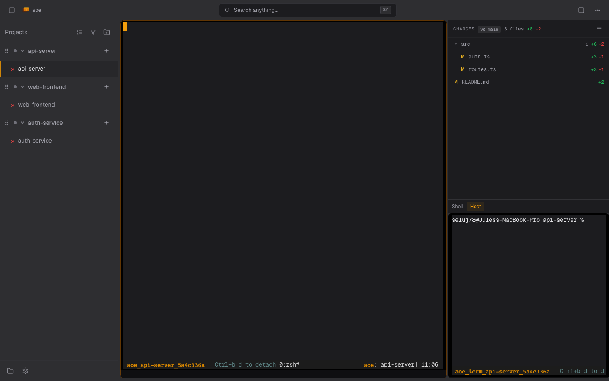

# Terminal View

For tmux-backed sessions the dashboard renders the agent's pane as a live terminal in the page, plus an optional paired shell. This page covers both terminals, how they are streamed, reconnect behavior, and the close codes you may see when a connection fails. For the structured-view rendering used by ACP sessions, see the [Structured view overview](../../structured-view.md).

## Agent terminal

The agent pane is streamed the same way on desktop and on a phone. The server renders the pane and pushes its rows over a WebSocket; the dashboard draws them as real text, so scrolling, selection and zoom are the browser's own. There is no xterm.js and no PTY attach.

Where it can, the server renders from the [VT live transport](../live-mode.md#the-vt-live-transport): the pane's output streams through `tmux pipe-pane` into an in-process terminal grid, a frame is published the moment the grid changes, and on tmux 3.8 or newer keystrokes travel back over the same socket (older tmux keeps `send-keys`). Full-screen agents that bracket each repaint in synchronized output (Claude Code's fullscreen renderer, for example) are published only between brackets, so the page never paints a half-drawn screen. Only rows that changed are sent after the first frame. When the transport is unavailable (tmux older than 3.4, `[tmux] vt_live = false`, a split window, or a pane whose grid could not be seeded), the server falls back to `tmux capture-pane` snapshots on a 50 ms cadence and delivers input with `tmux send-keys`. The fallback cannot withhold a half-drawn repaint. Add `?livedebug=1` to the URL to see which transport a session is using.

Scrolling up into history widens the window the server sends and surfaces a **Back to live** button; scrolling back to the bottom (or clicking it) returns to the live tail. The agent keeps running while you read.

## Copy and scroll

The terminal uses tmux for scrollback and selection, so copy and scroll work with no modifier keys:

- **Scroll** with the mouse wheel (or a one-finger swipe on touch) through tmux scrollback. Touch scrolling follows the finger like any native list: drag down to look back through history, drag up to head back toward the live tail.
- **Select** by click-dragging across the text. Dragging upward past the top edge scrolls into scrollback and extends the selection. Releasing the drag copies to your system clipboard automatically; no Ctrl/Cmd+C needed.

While a selection touches the terminal the pane stops repainting, so the agent cannot rewrite the text under it mid-gesture. Dragging upward still reaches older scrollback: newly captured history loads in above the held rows. The agent keeps running; the **Back to live** button appears for as long as the view is held, and clearing the selection (or clicking that button) catches it back up. A full-screen mouse agent also gives up its grip on touch gestures while a selection is live, so the selection handles can be dragged.

Mouse-enabled full-screen agents copy through OSC 52 instead: AoE forwards the agent's clipboard event through the live connection to the same browser clipboard path.

Copy relies on the browser Clipboard API, which only works in a secure context: HTTPS (the remote-access tunnel modes) or `http://localhost`. On a plain-HTTP LAN/VPN origin the browser blocks clipboard writes, so the selection stays visible but is not copied. Firefox is best-effort (it lacks the async clipboard write); Chromium and Safari copy reliably.

Agent capture, cursor modes, TTY identity and input stay pinned to the agent pane.
Focusing or zooming a secondary tmux pane does not retarget them.

## Paired terminal

Each session can open a **paired terminal**: a host shell (or, for a sandboxed session, one inside the container) rooted at the session's working directory. On desktop it shares the split with the agent terminal; on mobile it is one of the right-panel views. It stays alive in the background when you switch away. Its terminal 1 is the same shell the TUI opens with `T`, in the matching Host or Container mode.

On a writable server, opening or reconnecting either paired shell is refused while the session is held by a lifecycle operation such as purge. A live shell is preserved. Host recovery uses the current project directory; container recovery keeps its pinned working directory and reuses minted values while the container remains running.

For sandboxed sessions, the **Container** tab launches the container user's preferred shell, resolved inside the container (passwd entry, then `$SHELL`, then bash, sh). Candidates must be regular executable files and either have a recognized shell name or be listed exactly in `/etc/shells`. Known-compatible shells run in login mode; other authorized shells run plain. Minimal images without `getent` read `/etc/passwd` directly.

## Reconnect

If the WebSocket drops (network blip, tunnel re-auth, daemon restart), the terminal reconnects on a fast-start retry ladder (200ms, 400ms, 800ms, 1.5s, 3s, 6s, 10s) so transient warm-up failures recover in well under five seconds. A disconnect banner shows the current state; a permanently dead pane surfaces a manual retry button instead of looping.

Keystrokes and paste waiting for ownership confirmation belong only to that connection and target. Disconnect, reconnect, ownership loss, or a session/route change discards them; they never flush into a replacement connection. Compose drafts remain editable, and only fresh input can be submitted after the new connection confirms ownership. Native generation changes can invalidate input while the original Agent PTY still runs; a fresh connection can capture that surviving runtime without restarting it.

Server-side preparation and programmatic sends keep their original row creation, native generation and physical profile across waits. A creation receipt describes the runtime that operation actually created; it cannot attach an old send to a later replacement. Input completion records recency only, without consuming newer shelving or diagnostic state. Reconnecting or opening a pane is not evidence that an earlier operation succeeded.

Captured native IDs remain the owner across a label-only rename. Readiness and delivery do not reselect a target by its new name. A CLI replacement is checked against native storage even before the daemon cache reloads; it cannot inherit an earlier creation receipt.

A required native conversation publication that is positively refused can retire only its own new birth, not a peer's selected conversation. Uncertain publication is not proof of process death: a possibly applied commit remains governed by exact reconciliation, without automatic replacement or input replay.

### Terminal WebSocket close codes

When the browser fails to reach a working terminal, the disconnect banner shows the close code returned by the server:

| Code | Reason string     | Meaning                                                                                   | Client behavior            |
| ---- | ----------------- | ----------------------------------------------------------------------------------------- | -------------------------- |
| 1001 | `server shutdown` | Daemon is shutting down (SIGINT/SIGTERM).                                                 | Retry with normal backoff. |
| 1013 | `tmux_not_ready`  | Pane did not become capturable within 2s. Usually a benign warm-up on first session open. | Retry with normal backoff. |
| 1013 | `input_unavailable` | The captured native input scope changed, or delivery could not be confirmed. This does not assert that the pane died. | Retry with normal backoff; discard pending input, never replay it. |
| 4001 | `pty_dead`        | The live view was running but the pane permanently exited.                                | Show "Click retry" banner. |

## Read-only mode

With `aoe serve --read-only`, existing agent and paired terminals keep streaming output. The dashboard does not create or restart panes, claim ownership, renew ownership heartbeats, resize panes, or send keyboard, paste, or mouse input. Delete and triage actions are hidden too.

Compose drafts remain editable, but Send is disabled. Unsent input and unfinished clipboard gestures do not replay when writing becomes available again. An upload or terminal creation accepted before the policy changed remains accepted.

## On mobile

The phone renders the same live view, tuned for touch:

- **Scrolling is the browser's own scroll**: momentum, rubber-banding, and finger-true tracking, over the pane's real scrollback. For a full-screen agent, whose scrollback lives inside the app, a drag is forwarded to the app as wheel input instead, one line at a time and paced to the app's redraws.
- **Text selection is native**: long-press to select and copy, like any web page.
- **Typing** goes back over the same WebSocket. Tapping the terminal opens the soft keyboard, except in a full-screen app with mouse support, where a tap is a click; the floating keyboard button toggles it either way. The key row adds Esc, Tab, a `Ctrl` toggle, paste, and compose by default, and ends with Enter while the soft keyboard is closed if the row has room; pick and order its keys under Settings > Terminal. Toolbar key sequences consume the one-shot Ctrl modifier, including Enter, Ctrl+C, and held repeats. Drag the joystick above the keyboard button for arrow keys. Compose opens a text box for dictation, autocorrect, and long-press paste, and sends the text as one paste. Opening the keyboard never resizes the agent's pane.
- **Pinch** adjusts the font size; the pane is resized to the resulting grid once, when the gesture ends.

A "Back to live" pill appears while you are scrolled up; tapping it (or scrolling to the bottom) returns to the live tail. The pane stays mounted while you switch views so the connection and scroll position survive.

Add `?livedebug=1` to the dashboard URL to overlay frame rate, arrival-to-paint latency, and the share of updates that arrived as row patches.
