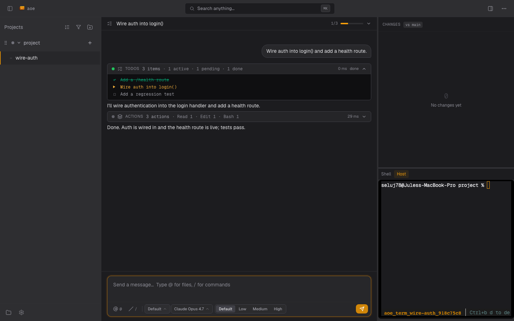

# Structured View (Web Dashboard)

The **structured view** renders agent state as plans, tool-call cards, diffs and approvals instead of terminal output. It is the web dashboard's default view and is also available in the native TUI, with mobile and multi-pane desktop layouts.

AoE is the client of the [Agent Client Protocol](https://agentclientprotocol.com/) (ACP), and the agent is the server. ACP-capable agents can use structured view or terminal view per session; agents without an adapter always use terminal view.



- **[Interface](structured-view/interface.md)**: surfaces, keybinds, composer, queued prompts, timeline grouping.
- **[Modes, approvals & model controls](structured-view/controls.md)**: permission modes, approval cards, notifications, model selectors.
- **[Troubleshooting](structured-view/troubleshooting.md)**: the security model and a field guide to each failure mode.
- Contributors: [Structured View Internals](development/internals/structured-view.md).

## Supported agents

aoe ships an ACP registry entry for each tool whose ACP server we've verified. For those tools the web wizard shows a per-session **Structured** switch (on by default). Tools not in the set, and custom agents without an ACP command, have no toggle and always run in the terminal view.

| Agent | ACP adapter | Install | Auth |
|-------|-------------|---------|------|
| `claude` | `claude-agent-acp` (Zed, recent version required) | `npm install -g @agentclientprotocol/claude-agent-acp@latest` | `claude login`, or `ANTHROPIC_API_KEY` |
| `codex` | `codex-acp` (ACP) | `npm install -g @agentclientprotocol/codex-acp@latest` | `OPENAI_API_KEY`, or ChatGPT login (local-only) |
| `opencode` | `opencode acp` (native, ≥1.16.0 recommended) | `curl -fsSL https://opencode.ai/install \| bash` | `opencode auth` / provider env |
| `gemini` (deprecated) | `gemini --acp` (native) | `npm install -g @google/gemini-cli` | `GEMINI_API_KEY`, OAuth, or Vertex |
| `vibe` | `vibe-acp` (native) | see [mistral-vibe](https://github.com/mistralai/mistral-vibe) | Mistral API key |
| `pi` | `pi-acp` (adapter) | `npm install -g pi-acp` (plus `@earendil-works/pi-coding-agent`) | `pi-acp --terminal-login`, or provider env |
| `omp` | `omp acp` (native) | `curl -fsSL https://omp.sh/install \| sh` | provider environment or OMP login |
| `kimi` | `kimi acp` (native) | `curl -fsSL https://code.kimi.com/kimi-code/install.sh \| bash` | `kimi login`, or provider env |
| `prime-agent` | `prime-agent --mode acp` (native 0.10.x) | `curl -fsSL https://app.primeintellect.ai/prime-agent/install.sh \| sh` | `/login` once, or provider env |
| `aoe-agent` | bundled (Vercel AI SDK 7, runs on the resolved Node) | `aoe acp doctor --fix --adapter aoe-agent` installs it into the data dir; nothing to install globally | provider env vars |


Gemini CLI is deprecated upstream for individual accounts since 2026-06-18. Enterprise and API-key authentication remain valid; Antigravity CLI is the replacement for consumer accounts.

The global npm installs above are optional. `aoe acp doctor --fix` can install Claude, Codex, Pi and `aoe-agent` adapters into the data directory; use `--adapter <name>` or `--all-adapters` to choose. See [Requirements](#requirements).

Tools outside the registry (aider, cursor, copilot, droid, hermes and kiro) use terminal view. Custom agents opt in with `agent_acp_cmd`, or inherit a supported base adapter through `agent_detect_as`. The inherited adapter does not execute the wrapper; pass account overrides explicitly. See [Configuration](guides/configuration.md#running-a-custom-agent-in-the-structured-view).

### Provider credentials

Each built-in adapter receives only verified provider variables from the Daemon's environment:

| Adapter | Forwarded |
|---|---|
| `claude` | `ANTHROPIC_API_KEY`, `ANTHROPIC_AUTH_TOKEN`, `CLAUDE_CODE_OAUTH_TOKEN`, `CLAUDE_CONFIG_DIR` |
| `codex` | `CODEX_API_KEY`, `OPENAI_API_KEY`, `OPENAI_BASE_URL`, `CODEX_HOME` |
| `opencode` | `ANTHROPIC_API_KEY`, `OPENAI_API_KEY`, `GOOGLE_GENERATIVE_AI_API_KEY`, `GOOGLE_API_KEY`, `GEMINI_API_KEY`, `OPENROUTER_API_KEY`, `OPENCODE_API_KEY` |
| `gemini` | `GEMINI_API_KEY`, `GOOGLE_API_KEY`, `GOOGLE_GENAI_USE_VERTEXAI`, `GOOGLE_APPLICATION_CREDENTIALS`, `GOOGLE_CLOUD_PROJECT`, `GOOGLE_CLOUD_LOCATION` |
| `aoe-agent` | `ANTHROPIC_API_KEY`, `OPENAI_API_KEY`, `OPENAI_BASE_URL`, `GOOGLE_GENERATIVE_AI_API_KEY` |
| `prime-agent` | `PRIME_API_KEY`, `PRIME_TEAM_ID`, and its verified provider, Vertex, Bedrock and AWS credential-chain keys. See the [adapter allowlists](https://github.com/agent-of-empires/agent-of-empires/blob/main/src/acp/install_hints.rs). |

`vibe`, `pi`, `omp`, `kimi` and custom adapters have no ambient provider allowlist. Supply host auth through `extra_env`, `environment`, or opt-in `session.inherit_host_environment`. Sandbox auth uses `sandbox.environment`; whole-host inheritance never crosses that boundary. Verified provider keys can cross, but ambient file/directory selectors, including config roots and AWS credential files, cannot: managed config roots are already mounted at canonical container paths. Explicit `provider_env` values are separate from ambient filtering. Drops are logged under `acp` with the key and reason.

### Prime runtime ownership

Native Prime Agent 0.10.x uses a daemon owned by each structured execution. Ownership follows the resolved ACP backend, including inherited custom agents, rather than the session tool label. The daemon and frontend receive the same effective environment and use the original agent directory for credentials, settings, skills, and history. Sandboxed preparation resolves Prime with the frontend’s executable, environment, working directory, and pinned container ID. AoE does not reuse a daemon launched with another session’s credentials.

Stopping or restarting a session requires process settlement before replacement. Runner retirement is bound to its registry generation, kernel birth identity, and boot. Linux uses pidfds; macOS uses audit-token PID versions. Linux 6.9 and newer can signal the original process group through a retained pidfd after the leader exits. A cold collector without an attested group anchor retains ownership. Foreign-user permission errors do not establish ownership; an uninspectable owned incarnation blocks retirement. Positively scoped native auxiliaries are fenced even if they detached with setsid. Detached runner expiry removes its record and sockets only after cleanup succeeds.

Successful cleanup removes the private runtime directory and retains a compact termination receipt in the AoE worker directory. The receipt binds launch evidence to its original host boot or guest PID namespace. A changed epoch invalidates old descriptors and launch PID files across retries. A missing runtime directory can settle only after the current census proves no owned processes remain. Definitive absence of the pinned container on its recorded runtime endpoint settles that guest's obligations without signalling host PIDs; stopped, paused, and unreachable containers are not treated as absent. The receipt’s absolute host path is pinned before applying the agent environment, and preparation commits it before launching native processes. Failure rolls back only the directory created by that attempt.

Container images must provide Bash and GNU grep for scoped process inspection, plus Python 3.9 or newer with `os.pidfd_open` and `signal.pidfd_send_signal` on the guest kernel. AoE probes pidfd signalling during preparation and binds guest signals to the recorded incarnation, without a numeric PID fallback. Missing capabilities refuse launch. Stopping `aoe serve` only detaches; an admitted turn continues and the next daemon reattaches to the same worker.

On Apple Container, worker descriptor snapshots are streamed as a tar archive by the guest Python helper. Symlinks and non-regular descriptors are refused; no host copy destination is used.

CLI stop and kill persist a stop intent before signalling. Reattachment, automatic respawn, queued turns, and runner publication respect that fence. Only an explicit resume after settled retirement can clear the stop intent it observed; a newer stop remains authoritative. For a tracked runtime that cannot prove settlement, externally stop only that execution on its original host or pinned container and retry `aoe acp stop <id>`.

A legacy Prime record without an attested native cleanup route cannot be retired automatically. Upgrades pin an existing control receipt only when it matches the recorded execution route; otherwise the route and ownership record remain intact with an unknown control path. First identify its original host or container and externally stop every native worker and service belonging to that execution. If that scope cannot be identified or its shutdown cannot be confirmed, retain the record. Do not use a global Prime shutdown that would affect unrelated executions.

After confirming native shutdown and verifying the original runner has exited, run `aoe acp recover <id> --confirm-prime-stopped` on the original worker host. The flag is an operator attestation, not proof obtained by AoE. Recovery refuses live original runners, attested native routes, non-Prime records, and changed execution identities. It retires only the selected record and runner sockets, not conversation history.

Malformed registry bytes remain an admission fence. After externally stopping the original runner and all its host or container native processes, use `aoe acp recover <id> --confirm-worker-stopped`. This covers unattested legacy runners and orphaned runner groups after external settlement. Recovery observes rather than signals: a known runner or group still executing, a live control-socket peer, changed evidence, or failed cleanup of an attested native route prevents retirement. Unidentified native receipts remain intact. If the original scope cannot be identified and stopped, retain the record rather than discarding it.

Prime 0.10.0 does not advertise ACP `session/load`: reattachment preserves a live session, but a cold ACP start creates a new native context and reports a context reset.

### Switching provider

A Claude session can be moved between the direct API, Bedrock, and Vertex without losing its transcript, from the provider picker next to the model picker or with `aoe acp switch-provider <session> <api|bedrock|vertex>`.

The pick only sets `CLAUDE_CODE_USE_BEDROCK` and `CLAUDE_CODE_USE_VERTEX`, and it outranks both the host environment and the `environment` list. Credentials are not provisioned by it: the target provider's own variables (`ANTHROPIC_VERTEX_PROJECT_ID` and `CLOUD_ML_REGION` for Vertex, the AWS credential chain for Bedrock) must already be present where `aoe serve` runs, or the next turn fails on authentication.

Two further effects are worth knowing before you switch:

- The model is reset to the new provider's default, because model ids differ between providers and a resumed conversation would otherwise stay on the model it last ran. Pick a model again afterwards if you had one pinned.
- A sandboxed session's container is recreated, since the GCP credential mount is decided when the container is built. Anything written inside the container but outside the workspace volume is lost.

The switch is refused while a turn or a background agent is running, since it restarts the worker. Once idle, the worker restarts and resumes the same conversation.

### Feature matrix

Features depend on the ACP adapter and its profile:

| Feature | Claude | Codex | OpenCode | Gemini | Other ACP |
|---------|:------:|:-----:|:--------:|:------:|:---------:|
| Streaming text, tool-call cards, approvals | ✓ | ✓ | ✓ | ✓ | ✓ |
| Mode picker | ✓ | depends | ✓ | depends | depends |
| Slash-command palette | ✓ | depends | ✓ | ✓ | depends |
| Usage / context-window display | ✓ | depends | ✓ | ✓ | depends |
| `/clear` boundary divider | `/clear` | `/new` | `/new` | none | none |
| TodoWrite / Skill / ExitPlanMode / ScheduleWakeup cards | ✓ | — | — | — | — |
| Subagent indentation | ✓ | — | unverified | — | — |
| Session resume across `aoe serve` restart | ✓ | depends | ✓ | depends | depends |

Capabilities depend on channels the adapter advertises; unavailable mode, slash-command or usage controls stay empty rather than stale. Codex currently advertises no Plan-mode channel. OpenCode 1.16.0 or newer improves edit/think classification, read output and permission context; older versions use generic cards and prompts. Report unexpected `tool.kind` and `tool.name` values. See [agent profiles](development/internals/structured-view.md#agent-profiles).

## Quickstart

In the web dashboard, create a session and choose an ACP-capable agent; **Structured** defaults on. The CLI and TUI default to terminal view unless configured otherwise. In the TUI, enable the offered **Structured** field; from the CLI:

```bash
aoe acp doctor
aoe add . --cmd claude --structured-view
aoe add . --agent codex --model gpt-5
aoe add . --agent codex --effort high
```

`--agent` implies structured view and refuses an uninstalled adapter with an install hint. `--structured-view` without `--agent` can fall back to terminal view with a warning. The TUI and the web dashboard refuse such a session with the same hint before anything is created. An adapter counts as installed when aoe finds it or it is on the PATH set by [`environment`](guides/configuration.md#host-environment). Sandboxed sessions skip the check, since the adapter runs inside the container, whose image must bundle it.

## Requirements

- Node.js 22+ on `PATH` (the structured view spawns an ACP agent subprocess); `aoe-agent` needs 22.6+ for `--experimental-strip-types` and declares `engines.node: >=22.6.0`.
- For Claude Code, a `claude login` session.

If Node is missing or too old, the session falls back to the terminal view with an actionable warning. Verify with `aoe acp doctor`:

```bash
aoe acp doctor                                  # reports Node + each configured agent's reachability
aoe acp doctor --fix                            # download bundled Node if missing, then install claude-agent-acp
aoe acp doctor --fix --adapter codex-acp        # install a specific adapter instead
aoe acp doctor --fix --all-adapters            # install every bundled adapter
```

`--fix` installs a pinned adapter under `$AOE_DATA_DIR/acp-worker/adapters/<adapter>/` using bundled Node's npm, without sudo or a global npm install. It installs only `claude-agent-acp` by default; use `--adapter` or `--all-adapters` for others. `aoe-agent` sources ship in the binary and its dependencies install the same way.

An adapter already on your `PATH` normally wins, so a manual global install keeps working. The exception is a `PATH` copy below the version floor aoe requires: rather than spawn a binary the agent handshake would reject, aoe uses the pinned bundled copy and logs the substitution. `doctor --fix` tells you when your `PATH` copy is the stale one.

It exits 1 if Node is missing, 2 if some agents are unreachable, else 0. Pass `--json` for machine-readable output. Install the native CLIs (opencode / gemini / vibe / omp / kimi / prime-agent) through their own channels.

## Choosing the view per session

- **Web wizard:** defaults to the structured view (set [`acp.default_new_session_view`](guides/configuration.md) to change it); turn off **Use structured view** to get the terminal view.
- **CLI / TUI:** default to the terminal view. From the CLI, opt in with `--structured-view` or `--agent`; in the TUI new-session dialog, toggle the **Structured** field (shown for ACP-capable tools).
- Either way, an existing active session can switch views: the web sidebar's right-click menu (**Switch to terminal** / **Switch to structured view**) or the TUI's right-click context menu (requires a healthy runtime; archived, trashed, and still-creating rows are excluded until they leave that state). Both surfaces confirm first. The worktree, open files, and commits are always preserved. For a **claude** session, the conversation is kept in both directions only when AoE can resolve a shared native store. A terminal switch whose store cannot be resolved, or which the structured worker does not share, is refused with HTTP 409 and `set-session-id --store` recovery guidance. Every other agent starts fresh on the target surface.

If the agent cannot resume a prior conversation, the transcript reports a context reset before assigning a fresh conversation. Recorded terminal context and an explicitly selected conversation count as prior context. Reattaching to the same live conversation does not add a reset.

Non-ACP tools always run in the terminal view, with no toggle.

See the [local Daemon workflow](quick-start.md#launch-the-tui) for startup, shutdown, and recovery. Structured sidebar statuses arrive through the runtime WebSocket. Reconnecting restores live state.

### Launch command and session naming

`--cmd <tool>` uses `session.agent_command_override`, preserving required ACP arguments, such as `opencode acp`. Adapter-backed agents use `session.agent_acp_cmd` for a full command swap. The wizard displays the resolved command read-only.

`aoe add` names a session from `--title`, then its worktree branch, then a generated name. `-i` or `--interactive` prompts as the TUI and wizard do. Set per-agent web defaults under `[acp.acp_defaults.<agent>]`, as shown below.

A structured session with a generated name can be titled after its first completed turn. Automatic rename changes only the title, never the directory or a manually chosen title. See [smart-rename settings](guides/configuration.md#session) for agent, sandbox and model rules.

Naming uses the whole first-turn transcript and waits until that turn ends, avoiding a concurrent one-shot against the live agent.

`session.smart_rename_agent` selects a one-shot-capable agent for titles and conversation summaries; empty uses the session's agent. **Auto-name now**, TUI `v`, or its command-palette action runs even with automatic naming off and can replace the current title. Automatic naming never replaces a manually chosen title.

Manual structured rename waits for the result and reports a skipped operation, provider failure, or deadline expiry without exposing provider output. An unsuccessful rename leaves the existing title intact.

The sidebar shows **Auto-name** for an eligible default-named session and **Naming…** while its title call runs.

Two chips flag a session that has parked itself but is still alive, so an agent waiting on background work does not read as a dead idle session. A `⏰` countdown shows when the agent scheduled a wakeup (a `ScheduleWakeup` call or a `/loop` run) and ticks down to the fire time. A `👁 monitoring` badge shows when the agent armed a `Monitor` (a background watch, for example waiting for a build or `cargo clippy` to finish); it has no fixed end time, so it stays put while the monitor keeps re-invoking the agent and clears once you send the session a new prompt.

```toml
[acp.acp_defaults.opencode]
model = "openai/gpt-5.5"
effort = "high"           # default thinking level
mode = "plan"             # default mode, applied when the agent advertises one

# Per-model thinking: overrides `effort` when that model is the resolved model.
[acp.acp_defaults.opencode.effort_by_model]
"openai/gpt-5.5" = "high"
"anthropic/opus" = "low"
```

`model` applies at worker start. `effort` and `mode` use advertised ACP config options and are skipped with a warning when unsupported. A matching `effort_by_model` entry overrides flat `effort`. Web **Structured View Defaults** exposes the same values from each agent's last advertised choices.

The `[acp]` block holds the structured view's global tuning knobs (timeouts, concurrency, watchdog grace). See [Structured View Internals](development/internals/structured-view.md#global-tuning-acp) for the full list.

## Agent artifacts

Each session gets a managed artifact directory, exposed to the agent as `AOE_ARTIFACT_DIR` (bind-mounted at `/aoe/artifacts` inside a sandbox). A screenshot or status file the agent writes there is served over an authenticated, session-scoped route and opens in the dashboard: transcript links open the file in a new tab, and markdown images render inline. Files written elsewhere (an arbitrary `/tmp` path, for example) cannot be served and render as plain, non-clickable text. To make a generated artifact viewable, write it under `$AOE_ARTIFACT_DIR`.

## Cross-machine attach

Set `AOE_DAEMON_URL` (and optionally `AOE_DAEMON_TOKEN`) to point at a remote `aoe serve`:

```sh
AOE_DAEMON_URL=https://aoe.example.com AOE_DAEMON_TOKEN=… aoe   # remote session picker
aoe acp attach <session_id> --daemon-url https://aoe.example.com
```

`AOE_DAEMON_URL` selects that Daemon for the TUI, `aoe serve --status` and Daemon-backed ACP commands. The TUI shows a remote session picker; tmux attach, `aoe stop`, file editing and worker recovery still need the original machine or SSH. Unset the variable to select the local endpoint again.

The remote picker uses bearer authentication only. Credentials require HTTPS outside loopback; an authenticated plaintext remote HTTP endpoint is refused. Runtime CLI reads alone permit non-loopback HTTP without credentials, and pin `localhost` to loopback without DNS. See [runtime CLI reads](api.md#runtime-cli-reads) for endpoint and fallback rules.

With no explicit remote or TCP endpoint, native clients use the local owner-verified Unix API and need neither credential variable. The kernel peer identity authorizes the connection, including when the dashboard runs with `--behind-proxy`. This is a same-OS-user trust boundary, not daemon-instance authentication; namespace and tmux checks establish runtime consistency. See the [native transport trust model](api.md#authentication).

For runtime reads and ACP requests to a daemon running `--auth=passphrase`, use `AOE_DAEMON_PASSPHRASE` instead of a bearer token. These clients share the `/api/login` handshake, device binding, and persisted session cache. Login secrets never follow redirects; loopback login bypasses environment proxies. ACP TCP discovery can also read the saved `serve.passphrase` file. A revoked cached session triggers a fresh login; failed authentication never substitutes local rows. TCP loopback callers remain a separate authentication path; behind a proxy, the passphrase wall applies to them too.

## Headless CLI verbs

Every structured-view operation has a matching `aoe acp <verb>` against the same daemon:

| Verb | What it does |
|------|--------------|
| `aoe acp history <id>` | Dump the persisted transcript |
| `aoe acp status <id>` | Print highest/lowest seq and the daemon source |
| `aoe acp prompt <id> <text>` | Send a prompt (`-` reads stdin) |
| `aoe acp approve <id> <nonce> [--always\|--deny\|--option <id>]` | Resolve a pending approval |
| `aoe acp cancel <id>` | Cancel the in-flight prompt |
| `aoe acp set-option <id> <config_id> <value>` | Set a model, mode or effort option on a running session |
| `aoe acp tail <id>` | Stream broadcast frames as JSON lines |
| `aoe acp attach <id>` | Open the TUI structured view for this session |
| `aoe acp stop` / `kill` / `restart` / `logs` / `switch-agent` | Worker management |
| `aoe acp recover <id> --confirm-prime-stopped` | Retire an identifiable missing-route Prime record after operator-confirmed native shutdown |
| `aoe acp recover <id> --confirm-worker-stopped` | Retire malformed or unattested legacy ownership after external shutdown confirmation |
| `aoe ps --acp` | List workers with their ACP columns (BUILD, MODEL, CWD, SOCKET); add `--dead` to include dead and orphaned ones. Replaces the removed `aoe acp ps` |

Daemon-backed verbs start a detached local daemon (loopback only) when none answers and print `Started aoe daemon (pid N)` on stderr. They never start one with `AOE_DAEMON_URL`/`--daemon-url` set, or with `--no-autostart` / `AOE_NO_AUTOSTART=1`; then they exit with a hint. Recovery operates on the local worker registry, so run it on the original worker host, using SSH for a remote host.
